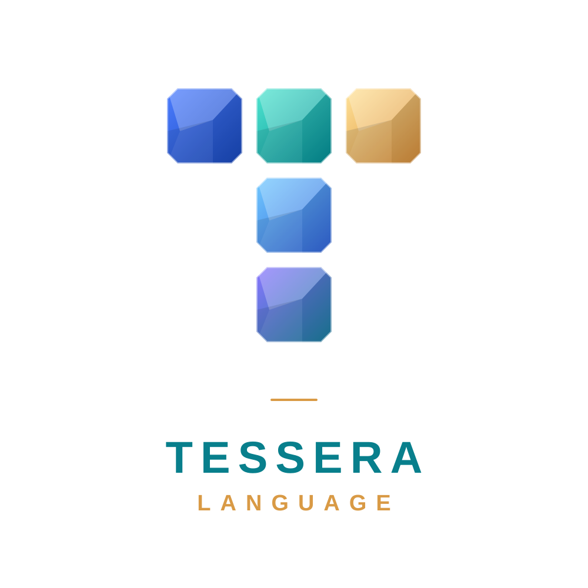

<h1 align="center">
  
</h1>

<p align="center"><strong>A compact, safety-first programming language designed for LLM-assisted software development.</strong></p>

Tessera aims to make it easy for language models to create, review, and maintain software without sacrificing clear behavior or safety. Its source is text, its syntax is intended to be compact and regular, and design rationale is preserved alongside code. **This is for humans that care about functionality of software, not about the code.**

> **Status:** Early design and proof-of-concept planning. The syntax and compiler are not yet stable. Examples below are proposals, not a working language release.

## Design goals

- **Compact, regular source:** Reduce unnecessary boilerplate without relying on cryptic abbreviations. Measure compactness using the intended model tokenizer, not character count alone.
- **Reviewable programs:** Make behavior, data flow, and external effects clear to an LLM reviewer.
- **Safety by default:** The planned safe subset excludes raw pointers and unchecked memory access, and uses bounds-checked collections.
- **Preserved rationale:** Attach design notes to declarations and preserve them through compiler tooling.
- **Portable native software:** The long-term goal is to compile for Linux, Windows, and macOS, with libraries for scripts, web applications, and desktop applications.
- **Self-hosting:** The long-term goal is to implement the Tessera compiler in Tessera itself.

These are design goals, not guarantees of the current prototype.

## Syntax sketch

The following example illustrates the direction of the syntax. It is not yet supported by a released compiler.

```text
note "Keep the age policy in one review point."
fn adult(age:i64)->bool = age>=18

fn label(name:str,age:i64)->str =
  (adult(age) ? "adult: " : "minor: ")+name

fn main()->unit !{io} = print(label("Ada",20))
```

The proposed `note` form records design intent. The `!{io}` annotation indicates that a function performs I/O.

## Compiler bootstrap plan

Tessera is planned to become self-hosting through staged compilation:

1. **Stage 0:** Build an initial compiler in Rust. It will compile a small Tessera subset to safe Rust, then use `rustc` to produce an executable.
2. **Stage 1:** Implement a Tessera compiler in Tessera and compile it with Stage 0.
3. **Stage 2:** Use the Stage 1 compiler to compile its own source. Run the same tests against both compiler versions.

Rust is the initial implementation and code-generation path, not part of Tessera's source language design. Native code generation can be considered after the language and compiler behavior are established.

## Initial POC scope

The first prototype is intended to cover a small, useful command-line program:

- Functions, parameters, return types, and local bindings
- Basic types: `i64`, `bool`, `str`, and `unit`
- Arithmetic, comparisons, conditionals, and string concatenation
- Lists, iteration, and checked indexing
- Explicit I/O effects and a minimal print operation
- Design notes preserved in compiler metadata
- Clear diagnostics and tests for invalid programs

Generics, concurrency, foreign-function interfaces, package management, GUI APIs, and web frameworks are outside the initial POC scope.

## Safety and security

Tessera is in very early stages and must not (yet) be treated as a security guarantee. The compiler, generated programs, and runtime will need testing and review. The initial design intends to avoid generating Rust `unsafe` code and to test that property, but that does not by itself prove the compiler or resulting software secure.

