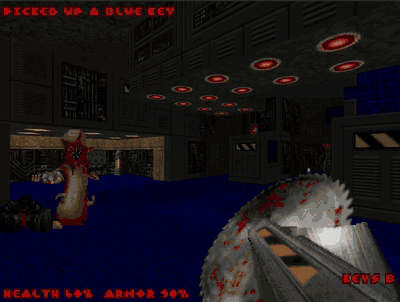

# Tesseradoom

A DOOM-style engine written in Tessera, following the DOOM roadmap (milestones M1 to M9). It is the
largest example program in this repository and the test bed for the language features it needs.

[](../../resources/tesseradoom.webm)

*Freedoom's E1M1 in Tesseradoom; click for the full recording
([`resources/tesseradoom.webm`](../../resources/tesseradoom.webm), 1:41).*

## Game data: not included

No WAD file is part of this repository, and none may be committed (decision D5). Put one in the
`WAD/` directory next to this file; everything in it except its `.gitignore` is ignored by git.

The engine is developed and tested with **Freedoom** (`freedoom1.wad`, the episode-based IWAD with
maps `E1M1` to `E4M9`):

1. Download the latest release from <https://freedoom.github.io/download.html>
   (developed against Freedoom 0.13.0).
2. Unpack it and copy `freedoom1.wad` to `WAD/freedoom1.wad`.

Freedoom 0.13.0's `freedoom1.wad` has SHA-256
`7323bcc168c5a45ff10749b339960e98314740a734c30d4b9f3337001f9e703d`.

Freedoom is distributed under a BSD-style license (see `COPYING.txt` in the Freedoom download).
Other IWADs, such as the shareware `doom1.wad` or a commercial `doom.wad`, should work too, but only
use files you have the right to use, and never commit them.

## License and sources

The engine is MIT licensed, like the rest of this repository (decision D4). It is written from
public descriptions of the WAD format and the game, not from the GPL DOOM source code or GPL ports
such as gldoom. Do not copy or translate code from them into this directory.

## Design decisions

The decisions D1 to D5 that shape this port are recorded in
[`docs/doom-decisions.md`](../../docs/doom-decisions.md): window and input through an extended `ui`
effect, 16.16 fixed-point numbers, at least 35 frames per second at 320 x 200, Freedoom as the game
data, and no bundled WAD files.

## Building and running

```sh
../../bin/tessera1 build main.tes -o tesseradoom --opt 3     # after ../../build.sh
./tesseradoom play E1M1                  # in a window (X11), 35 tics per second
./tesseradoom play E1M1 --no-monsters
./tesseradoom watch DEMO1                # play back a demo lump
./tesseradoom render E1M1 frame.ppm      # one frame from the player 1 start, as an image
./tesseradoom info                       # WAD type, lump count, map names
```

All commands: `info`, `map MAP`, `ascii MAP [WIDTH]`, `raycast MAP OUT.ppm`, `columns MAP`,
`render MAP OUT.ppm [X Y ANGLE]`, `bench MAP [FRAMES] [--still]`, `walk MAP`, `play MAP`,
`game MAP`, `demo DEMOn [TICS]`, `watch DEMOn`; `--wad FILE` before the command picks another WAD.
`walk` and `game` read commands from standard input (see `checks/m8_route.txt`).

Keys in the window: arrows or W/S to walk, Left/Right to turn, A/D (or `,` and `.`) to step
sideways, Shift to run, Space or E to use doors and switches, Control or F to fire, Escape to quit.

## Modules

| File | Contents |
|---|---|
| `wad.tes` | WAD header, directory, lumps by name, map lumps (M1) |
| `level.tes` | THINGS, LINEDEFS, SIDEDEFS, VERTEXES, SEGS, SSECTORS, NODES, SECTORS (M2) |
| `automap.tes` | ASCII map with integer line drawing (M3) |
| `geometry.tes` | 16.16 camera, column rays, ray/segment intersection, BSP point location |
| `raycast.tes` | One frame by raycasting against linedefs, no BSP (M4) |
| `art.tes` | Pictures, composed wall textures, flats, sprites, COLORMAP and PLAYPAL |
| `render.tes` | BSP renderer: textured walls, floors, ceilings, sky, lighting, sprites (M5) |
| `movement.tes` | Collision against linedefs (M6) |
| `things.tes` | Thing types: sprites, sizes, items, monsters |
| `world.tes` | The game: momentum, items, doors, lifts, switches, secrets, shooting, monsters (M8) |
| `play.tes` | The window: input, 35 tics per second, status line, demo viewing (M7) |
| `demo.tes` | Demo lumps (M9) |
| `main.tes` | Command line |

## Milestones and checks

`checks/run_checks.sh` runs every check below against `WAD/freedoom1.wad` (about 20 seconds; it
needs `python3` and Pillow). The compiler test suite runs it too when the WAD is present.

| Milestone | Status | Independent check |
|---|---|---|
| M1 WAD inspector | done | `checks/wadinfo.py`: type, lump count and the 36 map names are identical |
| M2 Map dump | done | `checks/mapdump.py`: counts and player 1 start identical for E1M1, E2M5, E3M7, E4M9 |
| M3 ASCII map | done | compared by eye with `checks/mapimage.py` (the same linedefs drawn with Pillow) |
| M4 Raycast frame | done | `checks/raycast.py`: a floating-point raycaster finds the same wall in all 320 columns, rows within one pixel, on four maps |
| M5 BSP rendering | done, checked by eye | no DOOM-compatible engine is installed, so there is no reference frame to compare with |
| M6 Movement | done | `checks/walkcheck.py`: 10,000 random single steps (80,000 during development) never come closer than 16 units to a wall or cross one |
| M7 Window and input | done | 684 frames per second uncapped in a 640 x 400 window (target 35); about 1,000 for rendering alone |
| M8 Gameplay core | done | `checks/m8check.py` on `checks/m8_route.txt`: health bonuses and shells picked up, the lift lowers, two doors open, the player ends in the secret room behind the second |
| M9 Demo parity | playback only | demos play back (version 1.9 format, momentum and friction as published); parity cannot be checked or reached, see below |

### M9: why there is no parity check

Matching the original game tic by tic needs (1) a reference run of the same demo by a
DOOM-compatible engine, which is not installed here, and (2) the original's exact game logic: its
random number table, the order in which things act, monster behaviour and collision details. Under
decision D4 those may only come from sources that are not GPL code, and the random number table in
particular comes from the GPL source release. This engine therefore uses its own randomness and
monster logic, so demo playback diverges as soon as monsters are involved: the recorded player
reacts to the original's monsters, not to these. What is checked instead is that playback obeys the
level: all four Freedoom demos, played without monsters (22,000 tics), never take the player
through or into a wall.

## Not implemented

Sound, weapons other than the pistol and shotgun (picking up others only adds ammunition),
projectiles (monsters attack with instant hits), monsters flying or floating, teleporters, crushing
ceilings, light effects, switch textures changing when pressed, the automap in the window, saving,
and the intermission screens.
